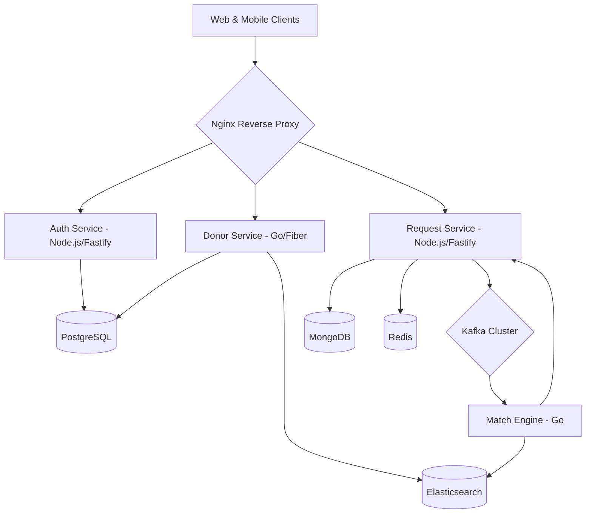

# 🩸 Blood Donation Platform

A high-performance, production-ready microservices architecture designed to bridge the gap between blood donors and those in urgent need. Built with a focus on real-time matching, geo-spatial accuracy, and extreme scalability.


---

## 🚀 Overview

The **Blood Donation Platform** is a comprehensive solution for managing blood donation requests and matching donors in real-time. By leveraging modern technologies like **Go**, **Fastify**, **Elasticsearch**, and **Kafka**, the platform ensures that life-saving requests are broadcasted and matched within milliseconds.

### Key Highlights:
- **⚡ Real-time Matching**: Instant donor discovery using Kafka-driven event streams.
- **📍 Geo-spatial Intelligence**: Advanced proximity searching via Elasticsearch and PostGIS.
- **📱 Multi-platform**: Seamless experience across Web (Next.js) and Mobile (Expo/React Native).
- **🛠️ Microservices Architecture**: Decoupled services for Auth, Donor management, and Request handling.

---

## 🗺️ System Architecture



---

## 🛠️ Tech Stack

| Layer | Technologies |
| :--- | :--- |
| **Frontend** | Next.js 14 (App Router), TailwindCSS, Framer Motion, Expo (React Native) |
| **Backend** | Go (Fiber), Node.js (Fastify, Prisma, Mongoose) |
| **Databases** | PostgreSQL, MongoDB, Redis |
| **Infrastructure** | Docker, Kafka, Elasticsearch, Nginx, Prometheus, Grafana |
| **DevOps** | Turborepo, GitHub Actions |

---

## 📁 Project Structure

```text
├── apps/
│   ├── web/          # Next.js 14 Frontend
│   └── mobile/       # Expo React Native App
├── services/
│   ├── auth-service/    # Authentication (Node.js/Prisma)
│   ├── donor-service/   # Donor Management (Go/GORM)
│   ├── request-service/ # Request Handling (Node.js/Socket.io)
│   └── match-engine/    # Real-time Match Engine (Go/Kafka)
├── infrastructure/      # Docker & Kubernetes configs
└── packages/            # Shared TS types and Go utilities
```

---

## 🚦 Getting Started

### 1. Prerequisites
- Docker & Docker Compose
- Node.js 18+
- Go 1.21+

### 2. Infrastructure Setup
Spin up the required databases and message brokers:
```bash
docker-compose up -d
```
*This initializes PostgreSQL, MongoDB, Redis, Elasticsearch, and Kafka.*

### 3. Service Initialization
Initialize the backend services (example for Auth Service):
```bash
cd services/auth-service
npm install
npx prisma db push
npm run dev
```

### 4. Frontend Launch
Start the web dashboard:
```bash
cd apps/web
npm install
npm run dev
```

---

## 🔐 Environment Variables

Create a `.env` file in the root based on `.env.example`:

| Variable | Description |
| :--- | :--- |
| `DATABASE_URL` | PostgreSQL connection string |
| `MONGODB_URI` | MongoDB connection string |
| `REDIS_URL` | Redis endpoint |
| `ELASTICSEARCH_URL` | Elasticsearch host |
| `KAFKA_BROKERS` | Kafka broker list |
| `JWT_SECRET` | Secret for authentication |

---

## ☁️ Deployment

- **Frontend**: Deployed on **Vercel**.
- **Go Services**: Hosted on **Render**.
- **Node.js Services**: Powered by **Railway**.

---

## 📜 License

Distributed under the MIT License. See `LICENSE` for more information.

---

<p align="center">
  Built with ❤️ to save lives.
</p>
